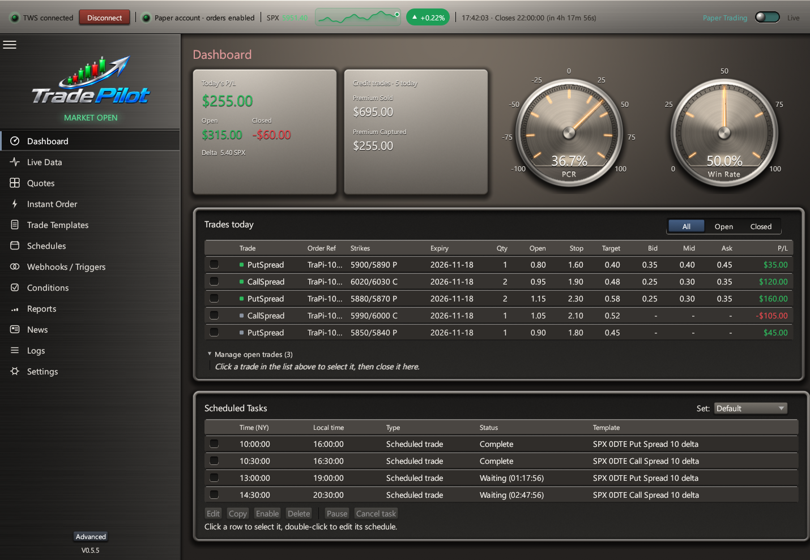

# TradePilot



<sub>The dashboard with made-up demo data (paper account, no real trades).</sub>


TradePilot is a free and open-source desktop application for options trading with
Interactive Brokers' Trader Workstation (TWS), written in Rust (egui). The complete source
code is published under the Apache License 2.0: anyone may use, study, change and pass it
on, also commercially (see [License](#license)). Its features are implemented step by step.

TradePilot is an independent project and is not affiliated with or endorsed by Interactive
Brokers.

**Orders are sent only when the connected account matches the chosen mode:** a paper
trading account in Paper Trading, a live account in Live. In Live every order is limited
to 1 contract. Try everything in Paper Trading first. TradePilot is not investment advice;
use it at your own risk.

## Features

- **Connection** to TWS only: account data, positions, market data and option chains.
- **Trade templates:** create, edit, duplicate, import and export; stored safely (see
  "Data"). Strike widths are checked against the strike distance of the option chain TWS delivered; without a chain for the symbol the editor says that they are not checked.
- **Instant Order:** a template trade (preview from the live option chain, confirmation,
  one combo order for multi-leg trades, fill attempts) or a single option, stock or
  future entered by hand.
- **Stops and profit targets:** placed once a template trade is filled (stop types,
  REL stops, guardrails, several profit target levels, stop adjustments), closing trades
  by hand, reconciliation with TWS after a connect and after every gap (see "Messages of TWS and what TradePilot does"). A stop or target of a running trade is attached or changed as a price or as a percentage; the unit has to be chosen. Changes made in TWS are taken over.
  Stop and target share one OCA group, so TWS cancels the other one with a deleted stop or target: TradePilot then places it
  again at its price, as the same kind of order, in a group of its own. While an order of another API client works on the
  contracts of a trade, TradePilot sends no stop or target for that trade and says why (both could fill and open a new position).
- **Dashboard and reports:** live P/L, premium sold and captured, PCR, win rate, delta,
  today's trades, reports with equity curve, daily view and CSV export; trade history
  rebuilt from TWS executions. This includes trades opened or closed elsewhere (another computer, by hand in TWS); a warning is raised when TWS no longer holds the options of an open trade.
- **Live data:** index quotes with the VIX9D/VIX ratio, and the open positions with price, market value and profit or loss (amount and percent) as TWS values them.
- **Positions without a trade:** option positions TWS holds that no open trade of TradePilot accounts for (opened by hand in
  TWS, by another program or on another computer) are listed with their DTE and the part that has no trade. Ticking the legs
  and "Take over as trade" makes them a trade: a window shows the trade and its entry price to check, then it is an open trade like
  any other (valuation, stop and target, closing). Nothing is sent to TWS when taking over.
- **Tables:** in the Dashboard tables and the live positions, columns are moved by dragging a header and sized by dragging the border between two headers (a double click on a border restores the widths); both are remembered.
- **Automatic entries:** a template trade can be entered at a set time on set days without
  anyone present, optionally only when a market condition holds. It goes through the same
  safety checks and the same order path as a trade entered by hand. Several schedules can
  be kept side by side and exchanged as files; the Dashboard shows what is due today.
- **Triggers, exits and re-entries:** webhook and EMA-crossover triggers, timed exits, early exits on conditions, progressive limit closing, re-entries, custom trades and conditions on market values.
- **News:** economic news (US first, then German and UK) on its own page and as a bulletin on the Dashboard, translated to German when the screens are German.
- **Stop management:** the stop of an open credit trade can change its legs as the market moves (a vertical stop becomes a short
  stop once the long has no bid or one at a set price or below, a short stop takes its long back once it has a bid again, 0-DTE
  stops buy back only the shorts from a set time on). The stop keeps its price and is placed again on the new legs. An IronFly,
  IronCondor-Full or ShortStrangle with a short stop can be split into one trade per side once a short is nearly worthless; each
  side then has a stop and a profit target of its own.
- **Safety features:** a trade can be closed automatically when it stays a set percent beyond its stop for a set time, or when
  TWS refuses its stop for margin; an entry refused for margin can be sent again up to three times. Warnings for missing stops,
  high slippage, a trade beyond its stop and more go by email or webhook (switches under Settings > Notifications); every
  email subject starts with "TradePilot:".
- **Housekeeping:** old log lines and files are removed after a set number of days, the settings are backed up once a day (the
  file name carries the computer name), and the trades of the day can be written to a CSV file after the close.
- **Metal design:** the one look of the whole app, modelled on brushed and polished metal: lit steel plates and frames, raised
  metal buttons, inset input fields, analogue dial instruments with glowing needles, LED status lights. Tables can be switched
  to a compact form for narrow windows.
- **Light and Advanced page sets:** Light shows only the most important pages (Dashboard, Instant Order, Trade Templates,
  Schedules, News, Logs and Settings), Advanced all of them; switchable in the sidebar. This is the choice of pages, not a colour scheme.


## Safety

- Every order takes one path to TWS: the safety gate (the account matches the Live/Paper
  mode, kill switch off), the risk check (maximum order quantity, 1 contract in Live), then
  the hand-over to the connection. An
  order that is refused or cannot be handed over is logged as `WARNING: order N NOT sent`
  and never recorded on a trade.
- **Risk limits** (Settings > Safety Features) hold up every order that opens a position:
  at most a set number of contracts open per symbol (default 20), no new position for the
  rest of the day once today's loss has reached a set amount (default $1,000), and at most a
  set number of new orders per minute (default 10). Orders that close or protect a position
  are never held up.
- While TWS has no connection to IB (message 1100) nothing is sent: the windows that send an order say why and grey out their send button.
- Immediate transmission is off by default; a confirmation window shows account, legs,
  limit and quantity before anything is sent. An order held in TWS for review is never
  changed or cancelled by TradePilot.
- The **kill switch** (Instant Order page) blocks every further order and cancels every
  order of TradePilot that may still be working, including stops; the log names the open
  trades left without a stop.
- A template trade is saved and counted only once TWS reports it completely filled.

## Requirements

- The [Rust toolchain](https://rustup.rs/) (version fixed in `app/rust-toolchain.toml`,
  installed automatically by `rustup` together with the `rustfmt` and `clippy`
  components) and a C/C++ toolchain: the Microsoft C++ Build Tools (MSVC) on Windows,
  the Xcode Command Line Tools on macOS, or the system's compiler and GUI development
  libraries on Linux (see "Installing the requirements" below for each).
- For the broker connection: a running TWS with the socket API enabled and a paper
  trading account (a live account for the Live mode). Market data needs the matching
  permissions at Interactive Brokers.

### Installing the requirements on a Windows PC

1. Install `rustup` (the Rust installer and version manager):
   ```powershell
   winget install Rustlang.Rustup
   ```
   Without `winget`, run `rustup-init.exe` from [rustup.rs](https://rustup.rs/) instead.
2. Install the Microsoft C++ Build Tools, needed to link on Windows (MSVC). The
   Visual Studio Installer component ID is `Microsoft.VisualStudio.Workload.VCTools`:
   ```powershell
   winget install Microsoft.VisualStudio.2022.BuildTools --override "--add Microsoft.VisualStudio.Workload.VCTools --includeRecommended --quiet"
   ```
   Alternatively, start the Visual Studio Installer by hand and select the
   "Desktop development with C++" workload.
3. Open a new PowerShell window (so the updated `PATH` takes effect) and change into
   `app/`. `rustup` reads `rust-toolchain.toml` there and installs the pinned channel
   with the `rustfmt` and `clippy` components automatically on first use; no separate
   `rustup component add` call is needed unless that file is missing.
4. Run `.\build.cmd` from the project root (see "Build and run" below) to build
   TradePilot. The first build also downloads all Cargo dependencies and can take a
   while.

To pass the application on to another Windows PC, only the matching TWS/IB Gateway
setup is required there (see "Passing the app on"); the Rust toolchain and MSVC Build
Tools are build-time requirements, not needed to run the finished `.exe`.

### Installing the requirements on a Mac

The macOS package is normally built by GitHub Actions (workflow `release.yml`, started by a
version tag); a Mac itself is only needed to build locally or to test the result. To build locally on a Mac:

1. Install the Xcode Command Line Tools (the Mac's C/C++ toolchain, the equivalent of
   the Windows MSVC Build Tools):
   ```bash
   xcode-select --install
   ```
2. Install `rustup`:
   ```bash
   curl --proto '=https' --tlsv1.2 -sSf https://sh.rustup.rs | sh
   ```
   (or `brew install rustup-init && rustup-init`, with [Homebrew](https://brew.sh/)
   installed first).
3. Open a new terminal (so the updated `PATH` takes effect) and change into `app/`.
   As on Windows, `rustup` reads `rust-toolchain.toml` there and installs the pinned
   channel with the `rustfmt` and `clippy` components automatically on first use.
4. From `app/`, run `./package.sh` to build (`chmod +x package.sh` first if needed).
   `./package.sh universal` builds one binary for Apple Silicon and Intel, `./package.sh --no-build`
   packs the release binary that exists already. The package is not signed: on the first
   start, right-click TradePilot.app > Open. `package.sh` is only for producing a release package
   (`.app`/DMG/ZIP); for day-to-day development use plain Cargo instead, the same way
   as on Windows (see "Build and run" and "Tests and checks" below, from `app/`):
   `cargo build`, `cargo run --bin trade_pilot`, `cargo test --workspace`,
   `cargo clippy --workspace --all-targets -- -D warnings`, `cargo fmt --all`. There is
   no macOS equivalent of `build.cmd`/`build.ps1` (PowerShell-only); VS Code with
   rust-analyzer works the same way as on Windows. The Windows-only parts of the code
   (`app/winui`) are excluded automatically on macOS via `cfg(windows)`, so the rest of
   the workspace builds and tests directly on a Mac.

### Installing the requirements on Linux

The Linux package (tar.gz) is built by GitHub Actions on Ubuntu 22.04 (job `linux` in
`.github/workflows/release.yml`); there is no helper script to start it from Windows or
to build it locally like `package.sh` on the Mac, so a Linux build is either done in CI
or by hand with Cargo.

1. Install `rustup`:
   ```bash
   curl --proto '=https' --tlsv1.2 -sSf https://sh.rustup.rs | sh
   ```
2. Install the system libraries the GUI (`egui`/`winit`) links against. On Debian/
   Ubuntu:
   ```bash
   sudo apt-get install -y libxkbcommon-dev libgl1-mesa-dev libwayland-dev \
     libx11-dev libxcursor-dev libxrandr-dev libxi-dev
   ```
   On other distributions, install the equivalent `-dev`/`-devel` packages (Fedora:
   `dnf install libxkbcommon-devel mesa-libGL-devel wayland-devel libX11-devel
   libXcursor-devel libXrandr-devel libXi-devel`; Arch:
   `pacman -S libxkbcommon mesa wayland libx11 libxcursor libxrandr libxi`).
3. Open a new shell and change into `app/`. `rustup` reads `rust-toolchain.toml` there
   and installs the pinned channel with the `rustfmt` and `clippy` components
   automatically on first use.
4. From `app/`, use plain Cargo for development, the same as on Windows and the Mac
   (see "Build and run" and "Tests and checks" below): `cargo build`,
   `cargo run --bin trade_pilot`, `cargo test --workspace`,
   `cargo clippy --workspace --all-targets -- -D warnings`, `cargo fmt --all`. To build
   the release package (tar.gz with launcher and icon) instead, run
   `./package-linux.sh` from `app/` (`chmod +x package-linux.sh` first if needed).
   `app/winui` is excluded automatically via `cfg(windows)`, as on macOS.

## Build and run

From the project directory:

```powershell
.\build.cmd              # release build
.\build.cmd --debug      # release and debug build
.\build.cmd -Run         # release build, then start it
.\build.cmd -SkipClippy  # without the separate Clippy pass (faster)
```

`build.cmd` (also works where PowerShell scripts are blocked) calls `app\build.ps1`. The
script runs Clippy, builds in `app\target\release` (debug: `app\target\debug`) and names
the executable `TradePilot-V<version>.exe` (`..._debug.exe`). The application is
recompiled on every call, also for an unchanged version; dependencies stay cached. Older
versioned copies are removed only after the new one exists. Only the debug version:
`app\build.ps1 -Debug`. The script ends running TradePilot processes first.

A build in a folder that OneDrive or a virus scanner watches can be many times slower; set
`CARGO_TARGET_DIR` to a folder elsewhere and the script builds and looks there.

The picture at the top of this file is drawn by the app itself, with made-up demo data instead of your own (no account, trades,
settings or files of yours are shown or changed):

```powershell
.\app\target\release\trade_pilot.exe --screenshot images\dashboard.png --page dashboard --demo --width 1430 --height 990
```

## Tests and checks

From `app/`:

```powershell
cargo fmt --all --check
cargo clippy --workspace --all-targets -- -D warnings
cargo test --workspace
```

Plus `cargo audit` and `cargo deny check` (see `app/deny.toml`). Tests that need a
real TWS are ignored.

## TWS connection

1. Start TWS, log in to the paper trading account and enable the socket API.
2. In TradePilot choose Paper Trading (switch at the top right) and set host, port and
   client id (defaults `127.0.0.1`, `7497` and `1`; host and port must match TWS, and the
   client id must not be in use by another API connection). TWS reports open orders per
   client id: keep the one the trades' orders were placed under.
3. Click "Connect to TWS" (top left). The bar shows the connection, the account type and
   the SPX price, or the price of the symbol chosen under Settings > Market Data.

Outside market hours TWS sends no live index ticks; TradePilot then shows the last daily
close (display only, never used as a trading price). With "Estimate SPX Extended Hours"
switched on, the bar shows an estimate of SPX from SPY instead, marked as one. If no prices arrive although the
connection is up, the same user is often logged in elsewhere (IBKR Mobile, Client Portal,
a second TWS; error 10197): log out there and reconnect.

### Messages of TWS and what TradePilot does

TWS reports problems as numbered codes. TradePilot acts only on codes whose meaning IB documents
(the IB TWS API "Message Codes" page); every other code of a message that belongs to no request is
logged as a warning ("unknown TWS notice, not handled") and otherwise ignored.

| Code | What it means (IB) | What TradePilot does |
|---|---|---|
| 326, 502, 503, 504, 507, 1300 | The API session is over or cannot start (client id in use, cannot connect, TWS out of date, not connected, socket ended, socket port reset) | Ends the session. "Maintain Connection" reconnects if it is switched on. |
| 1100 | TWS lost its connection to the IB servers (internet, nightly reset of the servers, a competing session) | Stays connected to TWS. Top bar: "TWS without IB connection - orders blocked". **No new or changed order is sent** (cancels still are): every window that sends an order shows why and greys out its send button, and a refused order is also said on the screen. Scheduled entries wait within their window. TradePilot asks TWS for its time right away and every minute and logs whether TWS answers, the proof that the API socket is still open (IB does not state it). After 2 minutes a warning mail, repeated every 15 minutes while it lasts. |
| 1101 | Connection to IB back, market data requests lost | Requests every price and the option chain again, then the executions of the day, then compares the working orders (a stop or target may have filled meanwhile). |
| 1102 | Connection to IB back, market data requests kept | Requests the executions of the day, then compares the working orders. |
| 2110 | Connection between TWS and the server broken, restored automatically | Warning in the log. |
| 2103, 2105 | A market data or historical data farm is disconnected | Warning in the log. When the last broken live farm is back (2104), every price is requested again. |
| 2104, 2106, 2158 / 2107, 2108 | A farm is connected / idle but available | Nothing (informational). |
| 2100, 2101 | The account updates of this client stopped or cannot start | Warning; the portfolio values of TWS are dropped, live positions are valued from option quotes where available. |
| 100, 10197 | Message rate exceeded / no market data during a competing session | Warning in the log. |

After every gap in which TradePilot heard nothing from TWS (a restart, a lost session, TWS without
IB connection) it compares its trades with TWS: executions, positions and working orders. TWS is
the source of truth; trades opened or closed elsewhere (another computer running TradePilot, by hand
in TWS) are recognised from the executions. A stop or target of TradePilot that TWS still reports as
working for a trade that is closed is cancelled, as it would open a new position.

## Passing the app on

```powershell
.\package.cmd            # release build, then a ZIP and (with Inno Setup) a setup program in app\dist
.\package.cmd -NoBuild   # package the release executable that exists already
```

The release build links the C runtime into the executable, so it runs on a Windows 10/11
computer without the Visual C++ redistributable; `package.ps1` refuses an executable that
still needs it. `TradePilot-<version>-portable.zip` holds `TradePilot.exe`, a `portable.txt` and a short guide
(`app\installer\README.txt`). The file `portable.txt` next to the program switches the **portable mode** on: the data
(settings, templates, trades, log) then lives in the folder `Data` next to the program instead of in
`%LOCALAPPDATA%\TradeWorkspace`, so the ZIP can be unpacked anywhere (a USB stick, say) and never touches or shows the data
of another installation. Without the file (the setup program, or a lone `TradePilot.exe`) the data is in the user folder as
before. `TradePilot-<version>-Setup.exe` needs Inno Setup 6
(`winget install JRSoftware.InnoSetup`); it installs without administrator rights, adds a Start
menu entry (a desktop icon on request) and an uninstaller. Neither package contains user data (the portable one starts with an empty `Data` folder):
settings, trades and the log stay in `%LOCALAPPDATA%\TradeWorkspace` and survive an uninstall.
The receiving computer needs TWS or IB Gateway with the API enabled.

## Data

Settings, logs and data are kept per OS: `%LOCALAPPDATA%\TradeWorkspace` on Windows,
`~/Library/Application Support/TradeWorkspace` on macOS, and `$XDG_DATA_HOME/TradeWorkspace`
(falling back to `~/.local/share/TradeWorkspace`) on Linux. Paper Trading has its own
`paper` subfolder (settings, templates, schedules, trades, executions). Trades and
executions are in the SQLite database `tradepilot.db`. Templates and schedules are
written as a whole (temporary file, then renamed); a file that cannot be read is set aside
as `<file>.unreadable-<date-time>`, never overwritten, and saving is blocked if even that
fails. The folder can be changed under Settings ("Database and log file storage
location"); it applies from the next start. This data and any credentials do not belong in
a public repository.

## Project structure

- `app/trade_pilot` - application, user interface, and everything that touches files, the network or TWS (storage, news, mail, webhooks).
- `app/strategy` - the pure trade logic without any I/O or screen: entry (strike selection, combo orders), exit (stops, profit targets, timed and early exits), conditions, templates and their editor form, trade rebuilding from executions, reconciliation, fees, pricing, reports, market calendar. Public items are documented; what comes in as an argument (including the time) is what makes it testable.
- `app/core` - shared types and calculations.
- `app/risk` - risk functions.
- `app/broker` - broker and TWS integration.
- `app/winui` - Windows-specific functions.

## Contributing

Bug reports, ideas and pull requests are welcome. Before a pull request, run the checks
under "Tests and checks". Contributions are accepted under
the same license as the project (Apache-2.0, section 5).

## License

TradePilot is open-source software, licensed under the
[Apache License, Version 2.0](LICENSE-APACHE). It comes without any warranty; trading
options involves substantial risk of loss.
